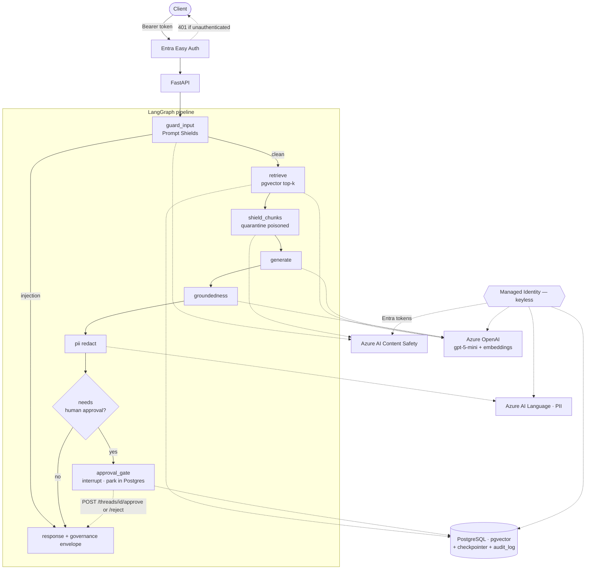

# azure-governed-rag

A ready-to-deploy, **governed RAG assistant** on Azure — retrieval over your own
documents, orchestrated with **LangGraph**, with the enterprise controls wired in
by default: **keyless identity, prompt-injection shields, groundedness checks,
PII redaction, a human-in-the-loop approval gate, and a privacy-safe audit
trail**. One command to stand it up (`azd up`).

> Built and maintained by [Smart Mobile House](https://smartmobilehouse.com) —
> secure AI implementation for enterprise.

Most "enterprise AI" starters are a chatbot with an API key. This is the
opposite: the boring, hard, regulated parts *are* the product. It's a reference
architecture a Head of Risk and an engineer can both read — keyless, auditable,
and reproducible from scratch — on portable, standards-based foundations.

## What makes it "governed"

- **Authenticated by default** — Entra (Easy Auth) in front; no anonymous endpoint.
- **Keyless** — every model, safety, language, and database call authenticates as
  a **managed identity**. No API keys or connection strings anywhere in the repo.
- **Safety in and out** — Prompt Shields on the user prompt *and* retrieved chunks
  (direct + indirect injection), plus a groundedness self-check on the answer.
- **PII redaction** — answers are screened by Azure AI Language; detected personal
  data is masked before it leaves the service.
- **Human-in-the-loop** — a LangGraph `interrupt` approval gate parks
  low-groundedness / sensitive / PII turns for an authorized human; state resumes
  across requests and replicas.
- **Auditable** — one privacy-safe record per turn: hashed excerpts, pseudonymous
  actor, sources, and policy/prompt/model version stamps. No raw content or identity.
- **Honest governance mapping** — [`docs/governance-mapping.md`](docs/governance-mapping.md)
  maps each feature to the control objectives it *supports* (NIST AI RMF / EU AI
  Act / ISO 42001). It is a mapping, **not** a compliance claim.

## Architecture

Keyless throughout — the container's managed identity gets short-lived Entra
tokens for every Azure service (including Postgres); no secrets are stored.



**Stack:** Azure Container Apps · Azure OpenAI (`gpt-5-mini` + `text-embedding-3-small`) ·
Azure AI Content Safety · Azure AI Language · Azure Database for PostgreSQL Flexible
Server (pgvector) · LangGraph · FastAPI · Bicep + `azd`.

## The governed pipeline

Every `/chat` turn runs through the graph above and returns a `governance`
envelope recording what each check decided:

| Stage | Control | On failure |
|---|---|---|
| `guard_input` | Prompt Shields on the user prompt | injection → **blocked** (short-circuit) |
| `retrieve` | pgvector cosine top-k | — |
| `shield_chunks` | Prompt Shields on retrieved chunks | poisoned chunk → **quarantined** |
| `generate` | Azure OpenAI, grounded prompt | — |
| `groundedness` | LLM self-check vs context | unsupported → fallback or human gate |
| `pii` | Azure AI Language | PII → **masked** (types + counts recorded) |
| `approval_gate` | LangGraph `interrupt` | sensitive/low-confidence → **parks for a human** |

Positive detections always act. When a check itself can't run, the fail-policy
decides: **PII and groundedness fail closed by default** (withhold or park); the
input/chunk shields follow `SAFETY_FAIL_CLOSED` (default open, flagged).

## API

All endpoints require an Entra identity. **Easy Auth is the authentication
boundary** — it validates the token and injects the caller's identity, and (while
enabled) Container Apps strips client-supplied `X-MS-*` headers. The app requires
that injected principal and rejects requests without it, but does **not**
independently validate the token; in-app JWT validation is a documented hardening
path (see [ADR 0001](docs/adr/0001-keyless-identity-and-auth.md)). The server
mints every `thread_id` and binds it to the caller.

| Endpoint | Who | Purpose |
|---|---|---|
| `POST /chat` | caller | `{message}` → `{status, thread_id, answer, sources, blocked, grounded, governance}`. A parked turn returns **only** `{status:"pending_approval", thread_id, reason}` — no answer. |
| `GET /threads/{id}` | **owner** | Status/result; returns the answer once the turn is approved (or the withheld message if rejected). |
| `GET /threads/{id}/pending` | **reviewer** | The question + answer of a parked turn, for an authorized reviewer to judge. |
| `POST /threads/{id}/approve` · `/reject` | **reviewer** | Release / withhold a parked answer. Never the requester (no self-approval); atomic; idempotent. |
| `GET /threads/{id}/audit` | owner or reviewer | The turn's privacy-safe decision trail. |
| `GET /smoke` | caller | Proves the keyless chain end to end (chat, embedding, Content Safety, pgvector). |
| `GET /health` · `/ready` | open | Liveness · dependency + database readiness. |

**Human-in-the-loop flow:** the gate activates only when a reviewer is configured
(`HITL_APPROVER_EMAILS`); with none set, a flagged turn resolves to a withheld/
fallback answer instead of parking, so it can never strand. When active, a
flagged turn parks and the requester gets a *reason only*. An authorized reviewer
(never the requester) reads `/pending`, then `/approve` or `/reject`, and the
requester polls `GET /threads/{id}` and receives the answer only once approved.

## Deploy

**Prerequisites**
- An Azure subscription with **Azure OpenAI access** and quota for `gpt-5-mini`
  and `text-embedding-3-small`
- [`azd`](https://aka.ms/azd), Azure CLI (`az`), a container builder
  (**Docker or Podman**), and [`uv`](https://docs.astral.sh/uv/)
- `psql` on the deploying machine (macOS: `brew install libpq` — the deploy hook
  finds the keg-only binary)
- **Region: `swedencentral`** — it has every service this template needs; the
  location is a Bicep parameter, but not all regions carry Content Safety +
  Language + Azure OpenAI + pgvector together.

```bash
az login && azd auth login
azd up          # preflight → provision (Bicep) → deploy image → postprovision hook
                #   the hook grants the managed identity a Postgres role, enables
                #   pgvector, and configures Entra Easy Auth (+ pre-authorizes the
                #   Azure CLI so you can mint a bearer token with no consent prompt)
```

**Call it** (the app is Entra-protected):

```bash
APP_ID=$(az ad app list --display-name "agr-$(azd env get-value AZURE_ENV_NAME)" --query "[0].appId" -o tsv)
TOKEN=$(az account get-access-token --resource "api://$APP_ID" --query accessToken -o tsv)
URL=$(azd env get-value APP_URL)

curl -s "$URL/smoke" -H "Authorization: Bearer $TOKEN" | python3 -m json.tool
curl -s "$URL/chat"  -H "Authorization: Bearer $TOKEN" -H "Content-Type: application/json" \
  -d '{"message":"what makes RAG governed?"}' | python3 -m json.tool
```

**Tear down** (stop idle spend):

```bash
azd down --purge --force   # --purge also removes soft-deleted Cognitive Services
```

### Cost

Nothing is billed for *creating* resources — only run-rate while they exist. Most
of the stack is consumption / scale-to-zero (approximate `swedencentral` list
prices; verify in Cost Management):

| Resource | Model | Idle |
|---|---|---|
| PostgreSQL Flexible Server (B1ms) | hourly | **~$0.02/hr (~$17/mo)** — the main standing cost |
| Container Registry (Basic) | flat | ~$5/mo |
| Container Apps | consumption | ~$0 (scales to zero) |
| Azure OpenAI, Content Safety, Language | per-call | ~$0 idle (pay per token/call) |
| Log Analytics / App Insights | per-GB | cents |

**Leave it up:** ~$0.70–0.80/day. **Spin up, test, `azd down`:** well under $1.

## Local development

Postgres runs locally; the AI services are still real Azure (there's no local
emulator), so `az login` provides the credential and your identity needs the
**Cognitive Services OpenAI User** role on the OpenAI account.

```bash
cp .env.example .env          # set the AI endpoints (from `azd env get-values`) + local Postgres
docker compose up -d          # local Postgres + pgvector
uv sync
uv run python scripts/ingest.py                       # seed the sample corpus
uv run python -m uvicorn app.main:app --reload        # http://localhost:8000/docs
```

`AUTH_DISABLED=true` in local `.env` bypasses Easy Auth (which only exists in Azure).

## Configuration

Governance is tunable via environment variables (see `app/config.py`):

| Setting | Default | Effect |
|---|---|---|
| `SAFETY_ENABLED` | `true` | Prompt Shields on input + chunks |
| `GROUNDEDNESS_ENABLED` | `true` | answer groundedness self-check |
| `PII_ENABLED` / `PII_CATEGORIES` | `true` / sensitive set | mask PII; the allowlist excludes noisy types (PersonType, Organization) |
| `PII_FAIL_CLOSED` | `true` | withhold the answer if the PII check can't run |
| `HITL_ENABLED` | `true` | human approval gate |
| `HITL_APPROVER_EMAILS` | `""` | reviewer allowlist. **Empty = the gate never activates** — a turn resolves (fallback/withheld) instead of parking, so it can't strand. Set it (a Bicep param wires it at deploy) to turn the gate on. |
| `HITL_SENSITIVE_TERMS` | `""` | terms that route a turn to approval (only when a reviewer is configured) |
| `HITL_ON_PII` | `false` | also route PII-containing answers to approval |
| `GROUNDEDNESS_FAIL_CLOSED` | `true` | withhold/park the answer if the groundedness check can't run |
| `SAFETY_FAIL_CLOSED` | `false` | block/quarantine when an **input/chunk shield** check itself errors |
| `AUDIT_HASH_KEY` | random, provisioned | HMAC key for audit/ownership pseudonyms. The **preflight hook generates a random key** and persists it in the azd env (stable across redeploys); a Key Vault reference is the stronger path. |

## Data handling & retention

- **Audit log** (`audit_log`) contains **no raw content or identity** — prompts
  and answers are keyed hashes, actor/approver are HMAC pseudonyms, sources are
  hashed, and governance is reduced to structural codes/counts.
- **Operational state is different.** The LangGraph **checkpointer** tables store
  each turn's **raw** question, retrieved chunks, and (pre-redaction) answer — this
  is what makes pause/resume work — in the *same* PostgreSQL server, with **no TTL
  by default**. A database reader or backup therefore sees raw content. If you run
  this on sensitive data, add a retention/cleanup job for the checkpoint tables and
  consider moving the audit log to a separate, access-controlled store. See
  [`docs/adr/0007-checkpoint-retention.md`](docs/adr/0007-checkpoint-retention.md).
- **TLS:** Postgres uses `sslmode=verify-full` in the container (the keyless Entra
  token is the connection credential). Local dev uses `sslmode=disable`.

## Evals & CI

`.github/workflows/ci.yml` runs lint, tests, a **deterministic governance eval
gate** (the real graph with Azure calls stubbed per case — injection blocked,
chunks quarantined, PII masked, sensitive turns gated, approve/reject), and an
image build. A separate live scorecard runs against a deploy. See
[`evals/README.md`](evals/README.md).

```bash
uv run pytest -q                                   # unit + governance eval gate
uv run pytest tests/test_governance_evals.py -q    # just the governance gate
```

## Troubleshooting

| Symptom | Cause / fix |
|---|---|
| `InvalidApiSetId: account type 'TextAnalytics' … unavailable` | Wrong region. Use `swedencentral`: `azd env set AZURE_LOCATION swedencentral` then `azd up`. |
| `FlagMustBeSetForRestore` on provision | Soft-deleted Cognitive Services from a prior teardown. `azd down --purge`, or `az cognitiveservices account purge …`. |
| `ServiceModelDeprecating` / model not found | The model+version are Bicep params; pick a current GA model for your region. |
| `psql: command not found` (postprovision) | Install libpq (`brew install libpq`); the hook finds the keg-only binary. |
| Image build segfaults on Apple Silicon | The image builds `linux/amd64` under emulation; this repo installs with `pip` (not the `uv` binary) for that reason. Use `docker.remoteBuild` (already set) to build in ACR. |
| `401` calling the app with a token | Token audience must be `api://<appId>`; the hook exposes the API + pre-authorizes the Azure CLI. |
| `/chat` returns an empty answer | gpt-5 reasoning models need `reasoning_effort` set or they spend the token budget on reasoning; this repo sets it. |

## Repository layout

```
app/            FastAPI app + LangGraph pipeline (rag/), keyless Azure clients
infra/          Bicep (subscription-scoped main + resources)
scripts/        preflight + postprovision hooks, corpus ingest
evals/          governance eval harness + dataset + live scorecard
docs/           BUILD-PLAN, governance-mapping, sample corpus
tests/          app tests + governance eval gate
```

## Status

M0–M4 complete and verified on a live deploy: keyless foundation, RAG, the full
safety layer, human-in-the-loop governance + audit, and the CI eval gate +
control mapping. Roadmap and decisions: [`docs/BUILD-PLAN.md`](docs/BUILD-PLAN.md)
and [`docs/adr/`](docs/adr/).

## License

[MIT](LICENSE) © Smart Mobile House
